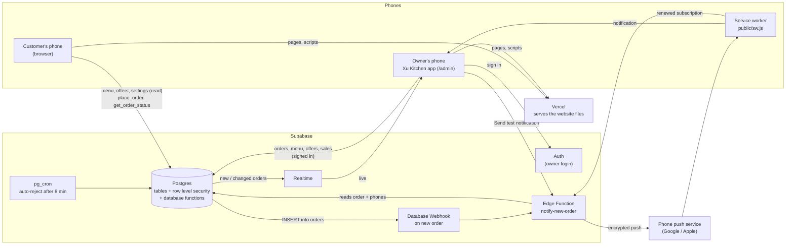

# Architecture

## The parts

## What runs where

| Where | What runs there |
| --- | --- |
| **Vercel** | Builds the Next.js app from GitHub and serves its files. `main` is the live site; other branches (e.g. `dev`) get preview links. There are **no server API routes**: every page runs in the browser and talks to Supabase directly. Vercel holds three public settings (environment variables); no secrets. |
| **Customer's browser** | Menu, cart, checkout and order status. Prices and offers are worked out in the browser for display (`lib/pricing.ts`), then the order is sent to `place_order`, which recalculates everything. The cart, saved address and recent orders are kept on the phone (`lib/storage.ts`). |
| **Owner's browser** | The `/admin` screens. The owner signs in with Supabase Auth. Orders arrive through Realtime (with a 30-second backup refresh). The chime is generated in the browser (Web Audio); the screen stays awake with the Wake Lock API. |
| **Service worker** (`public/sw.js`, owner's phone only, scope `/admin`) | Shows order notifications, opens `/admin` when one is tapped, and saves a renewed push subscription. It **never caches** pages, scripts or styles, and deletes old caches when it updates. |
| **Supabase Postgres** | All data. Row level security decides who can read or change what. Database functions do the work that customers aren't allowed to do directly (`place_order`, `get_order_status`) and build the sales report (`sales_summary`). A `pg_cron` job rejects unanswered orders every minute. |
| **Supabase Edge Function** `notify-new-order` (Deno) | Sends Web Push notifications. It's called by the Database Webhook on every new order, by the owner's "Send test notification" button, and by the service worker when a phone's subscription is renewed. |
| **Phone push services** | Google (Android / Chrome) or Apple (iPhone) deliver the encrypted notification to the owner's phone. Free; no account needed. |

## The main flows

**A customer places an order**

1. The menu, offers and delivery fee are read from Supabase with the public key.
2. The checkout sends the dishes, address and the **total the customer saw** to `place_order`.
3. `place_order` runs in the database:
   - It checks everything (dish exists, not archived or sold out, quantities, phone number and so on).
   - It takes prices from the database, never from the browser, and applies offers and GST.
   - It refuses the order with `PRICE_CHANGED` if its total differs from the one the customer saw (an offer may have just started or ended); the app then reloads prices and keeps the cart.
   - Otherwise it saves the order as `pending` and returns its id.
4. The phone remembers the order id. The status page asks `get_order_status` every 5 seconds.

**The owner hears about it**

1. Realtime pushes the new order to any open owner screen, which chimes every 10 seconds while the order is waiting.
2. At the same time, the Database Webhook calls `notify-new-order`. The function reads the order itself (it doesn't trust the request) and sends "🔔 New order #N · Collect ₹X" to every phone in `push_subscriptions`, removing phones whose subscription has expired.
3. The owner accepts (with a prep time) or rejects (with a reason). If nobody answers within 8 minutes, the `pg_cron` job rejects it with "Restaurant didn't respond".

**Order alerts stay on**

1. Each time `/admin` opens, it checks silently. If notification permission is granted, it makes sure this phone's subscription exists, isn't expiring and uses the current public key, and saves it to `push_subscriptions`. A replaced subscription is removed.
2. If the browser renews the subscription in the background, the service worker:
   - tells any open owner screen to save it, and
   - asks the Edge Function to swap the old address for the new one, which works even if the app is closed. The function only accepts this for an address it already has.

## Security model

**Two kinds of user:**

- **Customers** are not signed in. Their browser uses the project's *publishable* key, which is public by design, so it is visible in the website's code.
- **The owner** signs in with email and password through Supabase Auth.

**Every signed-in user is treated as staff.** That's why sign-ups must stay **off** in Supabase Auth and the owner's login is created by hand ([setup.md](setup.md)). If sign-ups were on, anyone could create an account and read customers' addresses and phone numbers.

| | Customer (not signed in) | Owner (signed in) |
| --- | --- | --- |
| Menu (`menu_items`) | Read | Read, add, change, mark sold out, remove from menu (no delete) |
| Offers | Read | Read, create, stop (no delete) |
| Settings (`restaurant_settings`) | Read | Read, change |
| Orders and order items | **No direct access.** Can only create one through `place_order` and see its status through `get_order_status` (needs the order's long random id; never returns the address or phone) | Read, accept / reject / cancel |
| Sales report (`sales_summary`) | No | Yes |
| Alert phones (`push_subscriptions`) | No | Read, add, remove |

**Why customers can't cheat on price.** The browser's prices are only for display. `place_order` is a `security definer` function: it runs with the database owner's rights, takes every price from the database, and rejects anything out of range.

**Secrets and where they live:**

| Secret | Where | Never in |
| --- | --- | --- |
| VAPID private key (signs notifications) | Supabase Edge Function secrets | GitHub, Vercel, the browser |
| Supabase service role key | Provided to the Edge Function automatically by Supabase | Anywhere else |
| Owner's password | Supabase Auth | Anywhere else |
| Database password | Password manager | Anywhere else |

The publishable key, project URL and VAPID **public** key are designed to be public; they're stored in Vercel environment variables, not in the code. The repository is public, so no key, password, email address or customer data may ever be committed.

**The Edge Function checks its callers itself:**

- **New-order requests:** only real orders trigger alerts. It re-reads the order and only sends for a fresh `pending` one.
- **Test notifications:** need a signed-in owner and go only to that owner's phone.
- **Renewals:** only replace an address that is already saved.

## Data kept on phones

| Key | Holds |
| --- | --- |
| `xu-noodles-cart-v2` | Cart lines |
| `xu-noodles-customer-v2` | Name, phone and address for next time |
| `xu-noodles-orders-v2` | The dishes of recent orders (for the status page) |
| `xu-kitchen-push-v1` | Owner phone: the last alert subscription saved |
| `sb-…-auth-token` | Owner phone: login session (managed by Supabase) |

Every item is versioned and checked when read (`lib/storage.ts`). Anything unreadable, old or the wrong shape is discarded on its own, never crashing the app. Two older items are handled automatically:
- **`xu-noodles-cart-v1`,** from the first live version: migrated into the new cart.
- **`xu-noodles-orders-v1`:** removed.
